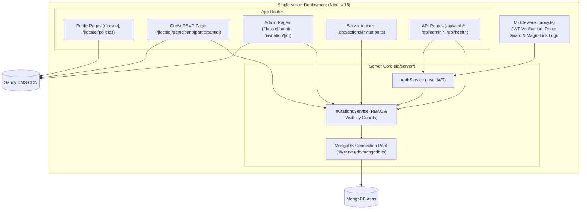

# Nuptiae

**Nuptiae** is a full-stack wedding website and RSVP management platform built with **Next.js 16 (App Router)**, **Sanity CMS**, and **MongoDB**, designed for a single, low-latency serverless deployment on **Vercel**.

---

## Table of Contents

- [Overview & Key Features](#overview--key-features)
- [Tech Stack](#tech-stack)
- [Architecture](#architecture)
  - [Authentication & Security Flow](#authentication--security-flow)
  - [Data Layer & Serverless Optimization](#data-layer--serverless-optimization)
- [Project Structure](#project-structure)
- [Database Schema](#database-schema)
- [API Route Handlers & Server Actions](#api-route-handlers--server-actions)
- [Environment Variables](#environment-variables)
- [Getting Started](#getting-started)
- [Deployment](#deployment)
- [License](#license)

---

## Overview & Key Features

1. **Public Wedding Website (`/[locale]`, `/[locale]/policies`)**
   - Content-driven sections managed via **Sanity CMS**:
     - **Hero**: Couple names, headline, and main cover image.
     - **Our Story**: Chronological timeline with alternating imagery.
     - **Wedding Details**: Ceremony date/time, location address, Google Maps link, and calendar export.
     - **Wedding List**: Gift registry instructions and links.
     - **FAQ**: Accordion of frequently asked questions.
     - **Countdown & Footer**: Live countdown to the wedding date and contact details.
     - **Cookie & Privacy Policies**: Dedicated policy pages (`/[locale]/policies`) and GDPR cookie consent banner.

2. **Guest RSVP Portal (`/[locale]/participant/[participantId]`)**
   - **Magic-Link Auto-Login**: Guests access their personal invitation via a unique URL (`/[locale]/participant/<id>?token=<secret>`). The Next.js middleware (`proxy.ts`) validates the secret against MongoDB and issues an HTTP-only JWT cookie (`at`).
   - **Interactive RSVP Form**:
     - Confirmation status (`CONFIRMED`, `PENDING`, `NOT_ATTENDING`).
     - Contact details (`email`, `phoneNumber`) and accommodation request (`isInterestedInAccommodation`).
     - Multi-participant management: add, edit, or remove family/group members with age category (`ADULT`, `CHILD`, `INFANT`), dietary preferences (`celiac`, `vegetarian`, `vegan`), and free-text `intolerances`.

3. **Admin Dashboard (`/[locale]/admin`)**
   - **Summary Metrics**: Live stat cards for total invitations, confirmed, pending, refused, total/confirmed participants, children (`3–8`), and infants (`0–2`).
   - **Invitation Management**:
     - Create new invitations directly from the dashboard (**New Invitation** modal).
     - Search by recipient or participant name, filter by confirmation status or accommodation need, and sort by name, status, or accommodation.
     - One-click **Share Link** button that copies the guest's personalized magic link (`?token=...`) to the clipboard.
     - Full invitation & participant editor (`/[locale]/admin/invitation/[id]`).
     - **CSV Export**: Downloads confirmed participants with dietary and accommodation details in UTF-8 with BOM (Excel-ready).

---

## Tech Stack

| Layer | Technology |
| :--- | :--- |
| **Framework** | [Next.js 16](https://nextjs.org/) (App Router, React 19, React Compiler, Turbopack) |
| **Package Manager** | [pnpm](https://pnpm.io/) |
| **Headless CMS** | [Sanity](https://www.sanity.io/) (`next-sanity`, `@portabletext/react`, `@sanity/image-url`) |
| **Database** | [MongoDB](https://www.mongodb.com/) (Official native `mongodb` Node.js driver) |
| **Authentication** | Stateless JWT in HTTP-only cookies (`at`) signed/verified with [`jose`](https://github.com/panva/jose) |
| **Internationalization** | [`next-intl`](https://next-intl.dev/) (default locale: `it`) |
| **Styling & Icons** | CSS Modules + [`lucide-react`](https://lucide.dev/) |
| **Hosting & Telemetry** | [Vercel](https://vercel.com/) + `@vercel/speed-insights` |

---

## Architecture



### Authentication & Security Flow

1. **JWT Cookie (`at`)**:
   - Stored as an `HttpOnly`, `SameSite=Lax`, `Secure` (in production) cookie with a 15-minute expiration (`Max-Age=900`).
   - Automatically refreshed in the background by the client-side [`TokenRefresher`](app/components/TokenRefresher.tsx) component calling `POST /api/auth/refresh`.
2. **Roles & Visibility**:
   - `admin` (`sub: "superuser"`): Full access to list, create, view, and update any invitation, including viewing each invitation's `secret`.
   - `user` (`sub: "<invitationId>"`): Scoped strictly to their own invitation ID; `secret` is stripped from DTO responses.
3. **Middleware Protection ([`proxy.ts`](proxy.ts))**:
   - Protects `/[locale]/admin/*` routes, redirecting unauthenticated users to `/[locale]/admin/login`.
   - Protects `/[locale]/participant/[participantId]`: if the visitor is neither an admin nor the authenticated owner of `participantId`, the middleware checks for `?token=<secret>`, authenticates in-process via `authService.signIn`, sets the `at` cookie, and redirects cleanly—or redirects to `/[locale]/error` if unauthorized.

### Data Layer & Serverless Optimization

- **Zero Self-Fetch Overhead**: Server Components and Server Actions invoke [`invitationsService`](lib/server/services/invitations.service.ts) and [`authService`](lib/server/services/auth.service.ts) directly in-process, avoiding double Serverless Function cold starts.
- **Native MongoDB Driver**: Uses the lightweight official `mongodb` driver instead of an ODM, with global connection caching (`globalThis._mongoClientPromise`) in [`lib/server/db/mongodb.ts`](lib/server/db/mongodb.ts) to reuse warm connections across Vercel invocations.

---

## Project Structure

```text
nuptiae-fe/
├── app/
│   ├── [locale]/
│   │   ├── admin/
│   │   │   ├── invitation/[id]/page.tsx   # Admin invitation detail & edit page
│   │   │   ├── login/page.tsx             # Admin login page
│   │   │   ├── layout.tsx                 # Admin layout with logout bar
│   │   │   └── page.tsx                   # Admin dashboard (stats, filters, list)
│   │   ├── error/page.tsx                 # Unauthorized / invalid token error page
│   │   ├── participant/[participantId]/   # Guest RSVP page
│   │   ├── policies/page.tsx              # Cookie & Privacy policy page
│   │   ├── layout.tsx                     # Root locale layout
│   │   └── page.tsx                       # Public wedding home page
│   ├── actions/
│   │   └── invitation.ts                  # Server Actions (create & update invitations)
│   ├── api/
│   │   ├── admin/
│   │   │   ├── invitations/route.ts       # GET / POST invitations (Admin REST API)
│   │   │   ├── login/route.ts             # POST admin login
│   │   │   └── logout/route.ts            # POST clear auth cookie
│   │   ├── auth/
│   │   │   ├── login/route.ts             # POST guest login (id + secret token)
│   │   │   └── refresh/route.ts           # POST refresh JWT cookie
│   │   └── health/route.ts                # GET health check
│   ├── components/                        # UI & Client components
│   └── i18n.ts                            # next-intl routing configuration
├── i18n/
│   └── request.ts                         # Server-side locale & timezone configuration
├── lib/
│   ├── api/
│   │   └── auth-client.ts                 # Browser fetch client for auth endpoints
│   ├── models/
│   │   ├── invitation.ts                  # Domain DTOs, Input types, and Enums
│   │   └── jwt.ts                         # JWT payload interface
│   ├── sanity/
│   │   ├── sanity.ts                      # Sanity client & image URL builder
│   │   └── types.ts                       # TypeScript interfaces for Sanity documents
│   ├── server/
│   │   ├── db/
│   │   │   └── mongodb.ts                 # Cached MongoDB client & collection helper
│   │   └── services/
│   │       ├── auth.service.ts            # JWT signing, verification, and auth logic
│   │       └── invitations.service.ts     # Invitations CRUD & authorization guards
│   └── logger.ts                          # Structured console logger
├── messages/
│   └── it.json                            # Italian UI translations
├── proxy.ts                               # Next.js 16 middleware (Auth & i18n)
└── next.config.ts                         # Next.js configuration
```

---

## Database Schema

All RSVP data is stored in the `invitations` collection in MongoDB:

```ts
interface InvitationDocument {
  _id: ObjectId;
  secret: string; // 24-char hex token used in the guest's magic link
  recipient: string; // e.g., "Famiglia Rossi"
  confirmationStatus: "pending" | "confirmed" | "not attending";
  email?: string;
  phoneNumber?: string;
  contactPersonId?: ObjectId | null;
  isInterestedInAccommodation: boolean;
  participants: Array<{
    _id: ObjectId;
    name: string;
    lastName: string;
    age: "adult" | "child" | "infant";
    intolerances: string;
    celiac: boolean;
    vegetarian: boolean;
    vegan: boolean;
  }>;
}
```

---

## API Route Handlers & Server Actions

### Route Handlers

| Method | Endpoint | Access | Description |
| :--- | :--- | :--- | :--- |
| `POST` | `/api/auth/login` | Public | Authenticates a guest with `{ id, token }` and sets the `at` cookie. |
| `POST` | `/api/admin/login` | Public | Authenticates an admin with `{ username, password }` and sets the `at` cookie. |
| `POST` | `/api/auth/refresh` | Authenticated | Verifies the current `at` cookie and issues a fresh 15-minute token. |
| `POST` | `/api/admin/logout` | Public | Clears the `at` cookie. |
| `GET` | `/api/admin/invitations` | Admin | Returns `{ invitations: InvitationDto[] }`. |
| `POST` | `/api/admin/invitations` | Admin | Creates a new invitation with `{ recipient }` and returns `201 Created`. |
| `GET` | `/api/health` | Public | Returns `{ status: "ok", date: "<ISO-8601>" }`. |

### Server Actions (`app/actions/invitation.ts`)

- `createInvitationAction(recipient: string)`: Admin-only action that creates a new invitation and revalidates `/[locale]/admin`.
- `updateInvitationAction(prevState, formData)`: Admin or invitation-owner action that updates confirmation status, contact info, accommodation interest, and the embedded participants list, revalidating both guest and admin pages.

---

## Environment Variables

Copy `.env.example` to `.env.local` and configure the following variables:

```dotenv
# Sanity CMS
NEXT_PUBLIC_SANITY_PROJECT_ID=your_sanity_project_id
NEXT_PUBLIC_SANITY_DATASET=production

# MongoDB
MONGODB_URI=mongodb+srv://<user>:<password>@<cluster>.mongodb.net/nuptiae

# Authentication & Admin Credentials
JWT_SIGN_KEY=your_jwt_signing_secret
ADMIN_USERNAME=your_admin_username
ADMIN_PASSWORD=your_admin_password

# Optional Feature Flags
NEXT_PUBLIC_ENABLE_PHOTO_UPLOAD=false
NEXT_PUBLIC_ENABLE_USER_ICON=false
```

---

## Getting Started

### Prerequisites

- **Node.js** `>= 22.x` (Node `24.x` recommended)
- **pnpm** `>= 10.x`
- Access to a **MongoDB** instance (local or MongoDB Atlas) and a **Sanity** project.

### Installation & Local Development

```bash
# 1. Install dependencies
pnpm install

# 2. Start the development server with Turbopack
pnpm dev
```

The application will be available at [http://localhost:3000](http://localhost:3000):
- **Public Home Page**: `http://localhost:3000/it`
- **Admin Login**: `http://localhost:3000/it/admin/login`
- **Admin Dashboard**: `http://localhost:3000/it/admin`
- **Guest RSVP Page**: `http://localhost:3000/it/participant/<invitationId>?token=<secret>`

### Available Scripts

| Command | Description |
| :--- | :--- |
| `pnpm dev` | Starts the Next.js development server. |
| `pnpm build` | Builds the application for production. |
| `pnpm start` | Starts the production server locally. |
| `pnpm lint` | Runs ESLint across the project. |

---

## Deployment

The project is configured for a **single deployment on Vercel**:

1. Connect the `giacomoRanieri/nuptiae-fe` GitHub repository to Vercel.
2. Configure the required [Environment Variables](#environment-variables) (`MONGODB_URI`, `JWT_SIGN_KEY`, `ADMIN_USERNAME`, `ADMIN_PASSWORD`, `NEXT_PUBLIC_SANITY_PROJECT_ID`, `NEXT_PUBLIC_SANITY_DATASET`) in the Vercel Project Settings.
3. Every Pull Request automatically generates a **Preview Deployment**; merging into `main` triggers a **Production Deployment**.

---

## License

This project is licensed under the **GNU General Public License v3.0** — see the [LICENSE](LICENSE) file for details.
